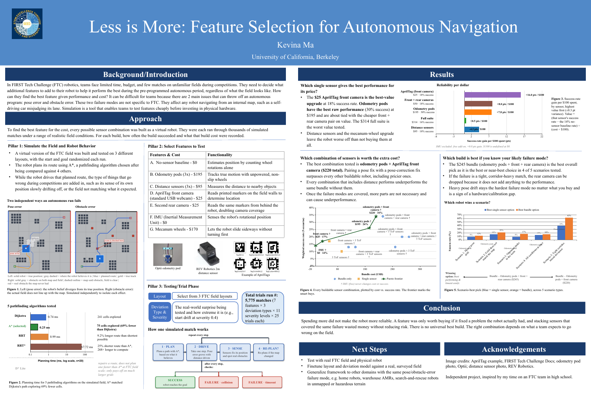

# autonomous-nav

### Less is More: Feature Selection for Autonomous Navigation

[](https://github.com/k-mma/autonomous-nav/actions/workflows/tests.yml)

**A pathfinding and sensor-strategy testbed for *FIRST* Tech Challenge (FTC)
robotics.** Five path-planning algorithms (Dijkstra, A\*, RRT, RRT\*, D\* Lite)
sit under a belief-planning and sensor-fusion layer that runs thousands of
controlled, repeatable autonomous-period trials — the statistical power a real
FTC season's ~10 matches can never supply — to answer one question: **which
sensors are actually worth the money, and when?**


Four sensor suites driving the *identical* seeded 30-second match, in real
time (`pygame_app/scenarios/scenario_ftc_suites.py`). The gray outline behind
each robot is where it *believes* it is; the gap is accumulated pose error.
AprilTag's camera FOV is the blue cone; the distance suite's three ToF cones
are the tan wedges, and the unshaded space between them is what it cannot see.
This is one scenario, not a ranking — the aggregate over 5,775 matches is in
[Results](#results).

## Headline results

- **Best value is not best performance.** A $25 AprilTag webcam returns 32x
  the success-rate gain per dollar of the $314 "buy everything" bundle
  (+16.0 vs. +0.5 points per $100), even though odometry pods alone post the
  highest raw success rate (30%). Stacking sensors hits diminishing returns
  fast. *(This ranking is tier-dependent — see the caveat under
  [Results](#results).)*
- **The "obviously better" fix backfires.** Naively merging AprilTag +
  odometry pods looks good (35% success), but a real confidence-weighted
  fusion of those same two sensors *drops* it to 22% — below odometry alone
  (25%). More sensors, fused more carefully, made the robot less reliable.
- **A "safe-looking" sensor can be the worst buy.** The 3-sensor distance
  suite is the only paid upgrade to land *below* the free baseline (10% vs.
  14%, p=0.003). Its cones see ~75° of 360°, and reacting to that fragment
  routes the robot into the 285° it cannot see.
- **Underneath it all, A\* explores 68.9% fewer cells than Dijkstra** for an
  identical-cost path — 241 vs. 75 cells across 20 random 25x25 grids. The
  planner is infrastructure here, not the finding; picking it was a
  completeness argument, not a speed one.

Numbers and 95% bootstrap CIs behind each claim: [Results](#results) below,
`benchmark_results/ftc_suite_writeup.md`, and [VALIDITY.md](VALIDITY.md).

## Poster

The one-page version of everything here, built for a research symposium at
UC Berkeley.

[](docs/poster.pdf)

**[Full-size PDF →](docs/poster.pdf)**

## Quickstart

Python 3.11+.

```bash
python3 -m venv nav-env
source nav-env/bin/activate
pip install -r requirements.txt
```

```bash
python3 pygame_app/main.py       # interactive visualizer (screenshot above)
python3 -m ftc.suite_benchmark   # regenerate the headline study (~1 min)
python3 -m ftc.recommend         # "which sensors should I buy" decision CLI
python3 -m ftc.optimizer         # which COMBINATION of sensors to buy
```

```bash
pip install -r requirements-dev.txt   # adds pytest
python3 -m pytest                     # CI runs this on every push
```

Preset scenarios, the PyBullet 3D demos, and every side-study benchmark are in
[WRITEUPS.md's command reference](WRITEUPS.md#command-reference). If `pip
install` fails building `pybullet` from source (common on very new
macOS/Xcode), the one-line fix is in WRITEUPS.md's "A build problem worth
documenting".

### Visualizer controls

| Key / click | Action |
|---|---|
| Left-click | Toggle obstacle |
| Shift + Left-click | Place/remove a moving obstacle |
| Right-click / Shift + Right-click | Place start / goal |
| `D` / `A` / `R` | Switch algorithm (Dijkstra / A\* / RRT) |
| Space | Run the active algorithm |
| `W` | Start/stop the robot walking the path |
| `H` | Cycle A\*'s heuristic |
| `X` | Toggle 8-directional movement |
| `M` / `K` / `S` / `C` | New maze / cost map / lidar sensor / clear |

## The research question

FTC autonomous is a 30-second dash: drive from a known start to a scoring
position on a pre-programmed route, with no driver input. Every team already
senses *something* — at minimum, motor encoders — and can buy more: odometry
pods, distance sensors, AprilTag vision, or all three. Each costs real money
and integration time.

Which one is worth it isn't obvious from specs, because the answer depends on
*which kind* of deviation shows up on a given field. A robot that starts a few
inches off its mark needs pose correction, not obstacle sensing; a field whose
elements don't match the CAD, or an opponent parked somewhere unplanned, needs
the opposite. These are two different failure modes with two different fixes,
not one generic "uncertainty" axis.


A team gets roughly 10 matches a season — one noisy, unrepeatable trial each,
no ground truth, no control over how far reality deviates from what the
routine assumed. That is not enough data to answer this empirically, no matter
how many matches they play. That's the actual thesis here: simulation is the
only viable instrument for this question, not a stand-in for hardware you'd
use if you had more of it.

`ftc/suite_benchmark.py` sweeps 7 sensor suites (`ftc/sensors.py`) against 3
independently-scaled deviation types (`nav/field_variance.py`) at 11 deviation
levels on a real 30-second budget (`ftc/match.py`) — 5,775 matches, in about a
minute. One match runs like this:


The split that makes the whole study work: the robot only ever acts on what it
**believes**, and the match is scored on what is **true**.

## Results

25 trials x 7 suites x 3 deviation types x 11 levels, on the "cluttered" field
layout. Full breakdown in `benchmark_results/ftc_suite_writeup.md`.


Three suites shown for legibility; the all-7 version with 95% bootstrap CI
bands is `benchmark_results/ftc_suite_comparison.png`.

| Suite | Cost | Success rate (variance_level >= 0.3) |
|---|---:|---:|
| Odometry pods | $195 | 30% |
| AprilTag (front camera) | $25 | 18% |
| Rear camera | $50 | 18% |
| Full suite | $314 | 16% |
| Dead reckoning (baseline) | $0 | 14% |
| IMU | $0 | 14% |
| Distance sensors | $95 | 10% |


Odometry pods wins on raw success rate; AprilTag wins on value by a wide
margin (+16.0 points per $100 over the free baseline, vs. the full suite's
+0.5 — a 32x gap). The suites the full bundle stacks on top run into
diminishing returns rather than each adding its standalone value again. Every
cost is a real, currently-listed vendor price (REV Robotics, Optii, Logitech);
see `ftc/config.py`'s per-constant source comments.

**The value ranking is tier-dependent, and this is the honest caveat.** Every
number in this section assumes `ftc/config.py`'s `"optimistic"` fidelity tier —
an omnidirectional camera and perfect heading knowledge, both real unmodeled
optimisms. `ftc/fidelity_benchmark.py` reruns the identical sweep one step
down, and best value flips from AprilTag (+16.0/$100) to **Odometry pods**
(+8.8/$100) at `"realistic"`, staying there at `"pessimistic"`. AprilTag's
raw-success and cost figures hold; its *best-value crown* does not survive
leaving the optimistic tier. [Detail](VALIDITY.md#camera-fov-heading-error)

### The most useful result is negative

The distance-sensor suite is the only paid upgrade that lands *below* the free
baseline — 10% vs. 14%, a paired difference of -4.0% (95% CI [-6.7%, -1.3%],
p=0.003). Adding a sensor measurably hurt.


The geometry is manufacturer spec, not an estimate: the REV-31-1505 has a 25°
field of view and 2m range, so three of them mounted front/left/right — the
usual FTC pattern — see ~75° of 360°. But the coverage gap alone would predict
*no benefit*, not active harm. The mechanism behind the harm shows up in the
per-trial data: these robots collide barely more often than dead reckoning
(79.5% vs. 77.3%), but they do it after 3.1 steps instead of 6.6. **Acting on a
fragment of obstacle truth diverts them into the 285° they cannot see**, where
dead reckoning at least follows a route planned against the whole assumed map.
More sensors don't rescue it — `ftc/coverage_benchmark.py` sweeps up to 8 ToF
sensors ($252) and success only moves 14% → 16%, because a 160° blind arc
survives any FTC-legal count.

**Scope this one carefully.** It is a finding about using ToF sensors as
general obstacle detectors, which is how this model deploys them. Real teams
more often use them for wall alignment and short-range squaring against a
*known* target — a use this study doesn't model at all, and one where a narrow
cone pointed where you already expect something is exactly the right tool. Read
it as "narrow-cone sensing plus reactive replanning is a bad general obstacle
strategy," not as "don't buy distance sensors."

### Which combination to buy

The table above compares fixed suites; a team's real question is a shopping
question. `ftc/bundle.py` composes suites into one working suite — costed over
the **union of their parts**, which is what reduces 63 raw combinations to 23
genuinely distinct robots — and `ftc/optimizer.py` searches that space.


This ran over two scenario catalogs, and they name different robots — worth
being explicit about, because the difference is the point rather than a
discrepancy:

| | Baseline catalog | Match-realistic catalog |
|---|---|---|
| Profiles / trials | 5 x 25 (2,875 matches) | 5 x 90 (10,350 matches) |
| Fidelity | optimistic | realistic |
| **Best average** | odometry + front camera ($220, 34%) | odometry + front + rear camera ($245, 26%) |
| **Best worst-case** | *everything ties at 0%* — so $0 wins | odometry + front + rear camera ($245, 12%) |
| Writeup | `ftc_optimizer_writeup.md` | `ftc_optimizer_match_writeup.md` |

Read that worst-case row carefully: in the baseline catalog *every* robot has
some scenario it never finishes, so "most robust" is a tie the free option wins
on price, not evidence that encoders are sturdy. The match-realistic catalog
separates them properly.

The match-realistic catalog is the one to trust for a purchasing decision: it
runs at realistic fidelity with mixed deviation axes per scenario, and there
best-average and most-robust name the *same* robot, so there's no tradeoff to
weigh. The optimistic catalog's headline $220 robot is the cheaper answer to an
easier question.

Per scenario (chart above), a bundle wins or ties everywhere — the $245 build
takes four of the five, and the $220 build takes the tight-corridor case, where
the rear camera has no room to earn its $25. The cost-vs-success Pareto
frontier over all 23 buildable robots is
`benchmark_results/ftc_optimizer_match_frontier.png`.

Either way the cheapest *significant* upgrade is the same: adding AprilTag to
odometry pods, +8.8% (95% CI [+4.0%, +14.4%], p<0.001) for $25.

Because every candidate runs the *identical* seeded scenarios, "is this bundle
better?" is answered with a **paired** bootstrap, not by checking whether two
independent CIs overlap. That distinction is not cosmetic: two candidates whose
independent CIs overlap heavily (20-50% vs. 35-65%) can have a paired
difference of [+5.0%, +27.5%], p=0.004.

Two findings worth stating plainly:

- **Bundling works, but only across capability categories.** Every bundle that
  significantly beat its own best single component spans more than one
  category (pose fixing / obstacle sensing / drift reduction / heading
  holding) *and* adds one that component lacked. Two sensors fixing the same
  failure mode don't stack. Buy across failure modes, not the two best sensors.
- **Greedy reasoning happens to work here.** On the baseline catalog, forward
  selection lands on the same robot as exhaustive search: from odometry pods
  (26%, $195), its one addition — AprilTag — is itself significant (p<0.001),
  and nothing further is worth adding.

## Threats to validity

Naming these plainly is what separates a research testbed from a demo. Full
mechanism, numbers, and CIs for all 12 are in [VALIDITY.md](VALIDITY.md);
the three that most constrain the headline result:

- **Synthetic ground truth.** Every trial's "ground truth" is a procedurally
  perturbed copy of the assumed map, not a measurement of a real field — a
  hypothesis about what deviation matters, not a validated one.
  [Detail](VALIDITY.md#synthetic-ground-truth)
- **Camera FOV and heading error.** Every number above assumes the
  `"optimistic"` fidelity tier (omnidirectional camera, perfect heading). The
  best-value suite does *not* survive the first step off it — it flips from
  AprilTag to Odometry pods at "realistic".
  [Detail](VALIDITY.md#camera-fov-heading-error)
- **No sensor-fusion conflict.** Bounded for AprilTag vs. odometry pods, open
  for every other pairing — this is the fusion reversal in the headline
  results above. [Detail](VALIDITY.md#sensor-fusion-conflict)

## How it fits together

<<<<<<< HEAD
  A separate, full-rigor question neither sweep above answers: does
  the *headline* best-value recommendation itself (AprilTag, measured
  under the default tank-equivalent drivetrain) hold for the large
  fraction of FTC teams that run mecanum? `ftc/
  drivetrain_suite_benchmark.py` reruns `ftc_suite_writeup.md`'s exact
  full-rigor sweep -- all 11 variance_level steps, all 3 deviation
  types, 25 trials/point, nothing reduced -- once per drivetrain, for
  all 7 headline suites (own output files, own labeled writeup,
  doesn't touch either sweep above). The answer: no -- the best-value
  suite is drivetrain-dependent, AprilTag under tank (the headline
  default) but Odometry pods under mecanum -- and every suite's raw
  success rate drops substantially on mecanum regardless, from -8
  points (Distance sensors) up to -15 (AprilTag (front camera) and Rear
  camera, the largest drops) -- see `benchmark_results/
  ftc_drivetrain_suite_writeup.md` for the full per-suite table.
- Camera field of view and heading error -- previously UNSTATED,
  now BOUNDED via `ftc/config.py`'s `MODEL_FIDELITY` tiers, not
  calibrated. Every number in this README before this addition assumed
  an omnidirectional camera (`ftc/sensors.py`'s `AprilTagSuite.
  tag_correction` accepted `heading_deg_now` and never used it -- a tag
  was detected regardless of which way the robot's camera actually
  faced) and perfect heading knowledge (`ftc/match.py` tracked pose
  error as a translation vector only, with no heading error anywhere,
  even though small angular error compounding into large lateral error
  over distance is the dominant real dead-reckoning failure mode). The
  "optimistic" tier reproduces that assumption exactly, by construction
  (see `ftc/scratch/fidelity_test.py`'s regression check) -- it is not
  a new, more honest default, it's the OLD default now given a name so
  it can be compared against something. "Realistic" and "pessimistic"
  add real camera-FOV gating, heading drift that actually rotates
  executed motion (not just a reported number), and, at the pessimistic
  tier, AprilTag detection dropout. `ftc/fidelity_benchmark.py`'s
  finding: the best-value suite does not survive even the first step
  off "optimistic" -- AprilTag (+16.0pp/$100) flips to Odometry pods at
  "realistic" (+6.1pp/$100) and stays there at "pessimistic"
  (+5.8pp/$100). Fidelity tiers BOUND this
  gap -- they
  make its size visible and swept -- they do NOT CALIBRATE it: every
  non-optimistic tier's constants (`CAMERA_FOV_DEG_BY_TIER`,
  `HEADING_DRIFT_DEG_PER_CELL_BY_TIER`, etc.) are documented ballpark
  engineering estimates, the same status as every other estimated
  constant in this file, until real measurements are run through `ftc/
  calibration.py`.
- No opponent modeling -- BOUNDED. The existing `unplanned_blocker`
  deviation type (one static obstacle, dropped once and left in place)
  is now joined by a `moving_blocker` variant in `ftc/
  opponent_benchmark.py`, which reuses `nav/obstacles.py`'s
  `MovingObstacle` (a seeded random walk, ticked on simulated match
  time) for a genuinely moving opponent, added alongside the static
  version rather than replacing it. The finding: a moving opponent
  changes which suite is the best value -- Distance sensors is best
  against a static blocker (+10.1pp/$100), while AprilTag (front
  camera) is best against a moving one (+24.0pp/$100, ahead of
  Odometry pods at +15.9pp/$100, with non-overlapping confidence
  intervals; Odometry pods still has the highest raw success rate
  against a moving opponent, 56%). Neither winner is Full suite --
  see `benchmark_results/ftc_opponent_writeup.md`.
  Suites that never sense obstacles at all still do substantially
  better against a moving opponent than a static one, purely from
  timing luck (a parked obstacle blocks a fixed plan deterministically;
  a wandering one often isn't there anymore by the time a blind suite's
  plan reaches that cell). The obstacle-sensing suites do not capture
  that benefit: Distance sensors drops from 16% to 6% and averages more
  collisions per match against a moving opponent (0.77 to 0.86). An
  earlier version of this benchmark reused one `MovingObstacle` and one
  ground-truth map across every suite in a trial, so each suite after
  the first started against an opponent the previous suite's match had
  already moved, with its move timer parked at that match's final
  simulated time; it now builds a fresh world per suite
  (`_build_trial_world`, with a regression test in `ftc/scratch/
  opponent_benchmark_test.py`). The static-blocker rows were unaffected
  (byte-identical before and after); 126 of the 1,925 moving rows
  changed. Still not modeled: the opponent has no goals of its own and
  doesn't react to this robot's presence -- a random walk is a step up
  from a fixed point, not a full multi-agent model.
- One field layout for the headline study -- CLOSED. `ftc/
  suite_benchmark.py` still runs on the `'cluttered'` layout only, but
  `ftc/layout_benchmark.py` reruns the identical full-rigor sweep on
  all three layouts `ftc/field.py` ships (sparse, cluttered, corridor)
  and checks whether the best-value suite changes: it doesn't --
  AprilTag is the best-value suite on every layout tested (see
  `benchmark_results/ftc_layout_writeup.md`). This closes the "would it
  shift on a different layout" question for the three layouts this repo
  actually ships; a season-specific surveyed layout dropped in later
  (see `ftc/field.py`'s module docstring) is still unchecked.
- Small, fast trials mean the 30-second budget rarely binds --
  CLOSED. `ftc/budget_benchmark.py` sweeps `AUTONOMOUS_PERIOD_S`
  downward (30s to 1.5s) and finds it now binds starting at 10s
  under the trapezoidal kinematics model above (it barely bound at all
  under the old naive drive-time formula) -- see `benchmark_results/
  ftc_budget_writeup.md`. Tightening the budget far enough does change
  which suite wins by raw success rate (Full suite overtakes Odometry
  pods as the #1 suite at 4s, a statistically clean change, CIs don't
  overlap), though the headline 30s budget itself still never binds in
  the actual headline sweep.
- Every match in this repo assumes a live, onboard A* replanner --
  BOUNDED. Real FTC teams overwhelmingly run a fixed, hand-tuned
  sequence of moves worked out before the match, not a pathfinder
  running live during it; this repo's entire match model assumed the
  opposite, unstated, until now. `ftc/match.py`'s `run_match(
  scripted_auto=True)` plans exactly once, from the assumed map, then
  drives that route with zero reconsideration -- no reroute for a
  sensed obstacle, a tag correction, or a stall (nav/policies.py's
  `OpenLoopPolicy` already names this exact concept -- "what a
  standard FTC autonomous routine does today" -- but its minimal
  grid-only interface couldn't carry this project's kinematics/sensor/
  fusion machinery, so the concept was reused and the code wasn't).
  `ftc/scripted_auto_benchmark.py`'s finding, restricted to the two
  deviation types an obstacle sensor has any mechanism to react to
  (`obstacle_drift`, `unplanned_blocker` -- pooling in `start_drift`,
  pure pose error, would dilute the exact question being asked):
  DistanceSensorSuite's live-replanning advantage over dead reckoning
  was already too small to separate from noise at this trial count
  (consistent with the blind-spot finding two bullets up), so this
  particular comparison can't cleanly show the predicted collapse --
  but the STRUCTURAL argument is confirmed directly regardless: a
  pose-fixing suite (AprilTag, Odometry pods) stays measurably ahead of
  dead reckoning even under scripted auto (correcting the believed-to-
  true position mapping still helps the SAME fixed route land closer
  to plan, no reroute required), while an obstacle-sensing suite's own
  `senses_obstacles` flag keeps sensing (harmlessly) with no avenue
  left to ever act on what it finds -- pose error and obstacle error
  really are different failure modes with different dependence on live
  replanning, not just different in degree. See `benchmark_results/
  ftc_scripted_auto_writeup.md` for the full breakdown, including the
  one modeling choice actually load-bearing here: the single plan
  `scripted_auto` makes is computed against the full assumed map
  regardless of sensor suite (a stand-in for a team planning by hand
  against the field's known layout), not against whatever a live
  sensor cone would have seen in the match's first instant -- getting
  that backwards would have penalized an obstacle-sensing suite's one
  plan for a reason unrelated to the actual question. Still open: a
  real hand-tuned routine can include contingency branches a team
  scripts by hand ("if blocked here, try this instead") -- a form of
  scripting with SOME reactivity this binary flag can't represent.

## Running the sweeps in parallel

Every full-rigor sweep (`ftc/suite_benchmark.py`, `ftc/layout_
benchmark.py`, `ftc/fidelity_benchmark.py`, `ftc/drivetrain_
suite_benchmark.py`, and `nav/uncertainty_benchmark.py`) runs its
independent trial batches across worker
processes via `run_sweep()`/`ProcessPoolExecutor` instead of a plain
sequential loop, roughly 1.9x faster on the 8-core machine this was
measured on (11.8s median down to 6.2s for the then-4,125-row headline
sweep -- IMU and Rear camera's later promotion into SUITE_ORDER grew
the sweep to 5,775 rows, not remeasured for timing at that size, though
nothing about the parallelization mechanism itself is suite-count
dependent; scaling is sublinear -- 2 workers already gets to 8.4s, 8
workers only to 6.2s -- because each of the 33 (deviation_type,
variance_level) combos is a different amount of work, and 33 combos
split unevenly across many workers leaves some idle while the biggest
combo finishes). Every seed a trial uses was already derived from that
trial's own `(deviation_type, variance_level, trial_index)` coordinates
before this change (`base_seed(deviation_type, level) + trial_index`,
`ftc/suite_benchmark.py`), so no state is shared between combos and
running them out of order or on different workers cannot change a
single result: `ftc/scratch/suite_sweep_parallel_test.py` and `nav/
scratch/uncertainty_sweep_parallel_test.py` prove this by running the
same reduced sweep at 1, 2, and 3 workers and diffing every non-timing
column of the output, and a full parallel run of the actual headline
sweep reproduces `ftc_suite_results.csv` with zero mismatches across
all 5,775 rows. `ftc/budget_benchmark.py` is a deliberate exception --
it works by monkeypatching `ftc.match.AUTONOMOUS_PERIOD_S` before
calling into the sweep, which only reaches a subprocess's own copy of
that module under `fork` (Linux), not `spawn` (macOS/Windows's
default), so it forces `max_workers=1` rather than depend on
which platform happens to be running it. `ftc/opponent_benchmark.py`,
`ftc/coverage_benchmark.py`, `ftc/newsuites_benchmark.py`, `ftc/
gearing_benchmark.py`, and `ftc/drivetrain_benchmark.py` have their own
separate sweep loops with different signatures and were not
parallelized here.

## Repo layout

Pygame-only and PyBullet-only code live in their own top-level
directories, separate from each other and from the shared `nav/` core.
(Neither is named literally `pygame/` or `pybullet/` -- a directory with
that exact name, sitting on `sys.path`, would shadow the real installed
library of the same name for `import pygame`/`import pybullet` anywhere
in the project.)
=======
`nav/` is a domain-neutral belief-planning library — grid, planners, sensor
and occupancy models, benchmarks — with no FTC-specific identifiers anywhere
in it. `ftc/` is a separate package holding the domain specialization (an 18in
robot, a 144in field, a 30-second clock, AprilTags). Keeping the boundary at
the package level, rather than scattering FTC `if` branches through `nav/`, is
what lets the core stay reusable for a different robot, field, or competition.
>>>>>>> 94b3de02fe0017fee7a0ea44740e3647d1a8320c

```
nav/           Framework-agnostic core: grid, planners, sensor/occupancy
               models, field variance, policies, stats, benchmarks
ftc/           FTC domain layer: field, sensor suites, match model, the
               headline study, bundle optimizer, decision CLIs
pygame_app/    2D interactive visualizer + preset scenarios
pybullet_app/  3D port: single-robot, multi-robot, and CBS demos
benchmark_results/  Generated CSVs, plots, and writeups
docs/          Symposium poster
```

Neither app directory is named literally `pygame` or `pybullet` — a directory
with that exact name on `sys.path` would shadow the real installed library.
The file-by-file tree is in
[WRITEUPS.md](WRITEUPS.md#repo-layout-the-full-annotated-tree).

### Planners

Every planner is a backend `nav/algorithms.py`'s `find_path` can swap in, but
`ftc/` uses A\* exclusively — and the reason is a completeness argument, not a
speed one. Dijkstra and A\* are resolution-complete (guaranteed to find a path
at the grid's resolution if one exists); RRT is only probabilistically
complete (guaranteed as sample count → ∞, not at any fixed budget).
`nav/scale_benchmark.py` shows that gap as measured incompleteness as grids
grow:


| Size | Dijkstra | A\* | RRT (k-d tree) | RRT found path |
|---:|---:|---:|---:|---:|
| 20x20 | 0.465ms | 0.227ms | 0.443ms | 8/8 |
| 50x50 | 2.679ms | 0.762ms | 1.520ms | 8/8 |
| 100x100 | 9.732ms | 1.156ms | 15.162ms | 7/8 |
| 200x200 | 56.511ms | 9.968ms | 58.548ms | **5/8** |

A 100x increase in cells grows Dijkstra's runtime ~120x but A\*'s only ~44x.
`nav/kdtree.py`'s spatial index made RRT faster than Dijkstra at every size
above (it used to be 620x slower) — but the completeness gap is untouched by
that, which is the point. RRT/RRT\* stay in the repo as measured baselines for
*why* an exhaustive heuristic search wins here, not as something `ftc/` should
reach for. `nav/rrt_star.py` and `nav/dstar_lite.py` (measured against fresh
A\* in `nav/replan_benchmark.py`) round out the set.

`pybullet_app/` ports the identical `nav.grid.Grid` into 3D and plans with the
same unmodified `find_path`: a Husky driven by velocity control along a
spline-smoothed route, a real raycast lidar (`pybullet.rayTestBatch`, 48 rays)
that replans on discovery, a two-robot corridor conflict, and an N-robot
intersection coordinated by `nav/cbs.py`'s Conflict-Based Search. Mechanics,
build stories, and the bugs found along the way are in
[WRITEUPS.md](WRITEUPS.md).

## Further reading

- **[WRITEUPS.md](WRITEUPS.md)** — algorithm mechanics, the admissibility
  argument, cost map and sensor model design, the PyBullet port, sweep
  parallelization, the full repo tree, and the command reference.
- **[VALIDITY.md](VALIDITY.md)** — all 12 threats to validity, each with its
  mechanism, numbers, and current status.
- **`benchmark_results/`** — every study's raw CSV, plot, and writeup.

---

Independent project, inspired by my time on an FTC team in high school.